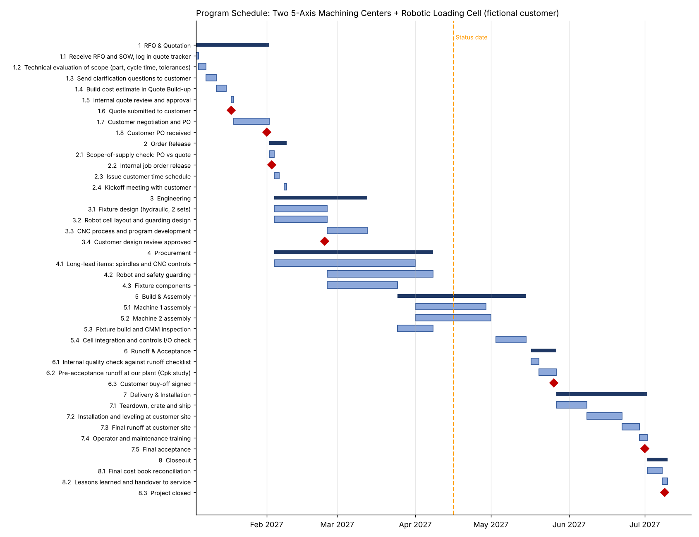

# Program Plan & Cost Book: 5-Axis Machining Cell

A mock capital-equipment project, built to practice the core job of a machine-tool project manager: turning an RFQ into a quote, then running the order through schedule, cost and customer acceptance.

**Scenario (fictional):** Lakeshore Drivetrain Co. orders two 5-axis horizontal machining centers, two hydraulic fixture sets and a robotic loading cell to machine an aluminum transmission housing. All names and figures are illustrative.

## What's in here

| File | What it is |
|---|---|
| `Machining_Cell_Program_Plan_and_Cost_Book.xlsx` | The working model: dashboard, schedule with Gantt, quote build-up, cost book, change log, risk register, runoff checklist |
| `Machining_Cell_Program_Plan.xml` | The same schedule in Microsoft Project XML format. Opens in Microsoft Project or the free ProjectLibre |
| `gantt.png` | Schedule snapshot |

## How the model works

- **Quote Build-up:** RFQ scope broken into 12 cost lines (machines, fixtures, automation, labor hours, freight, install, warranty, contingency), marked up to a sell price of about $2.38M at a ~18% quoted margin.
- **Schedule:** 27 tasks and 7 milestones across RFQ, order release, engineering, procurement, build, runoff, install and closeout. Start dates are driven by predecessors with `WORKDAY`, so changing one duration ripples through the plan. The Gantt redraws from the dates.
- **Cost Book:** budget vs committed vs actual vs estimate-to-complete per line, with EAC and variance. Overruns on the machines and the robot cell are absorbed by releasing contingency.
- **Change Log:** three customer changes priced as supplementary quotes. Only approved ones roll into the revised contract.
- **Dashboard:** contract value, forecast margin, % complete, late tasks and an overall status for the customer program review.

Status date in the model is April 16, 2027: the robot cell is running late, both machines are mid-assembly, and the program is AMBER.

## Tools

Microsoft Excel (WORKDAY, SUMPRODUCT, SUMIF, conditional formatting), Microsoft Project XML.
